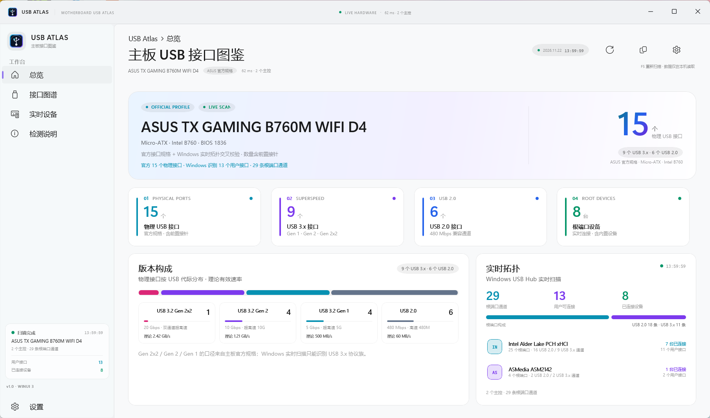
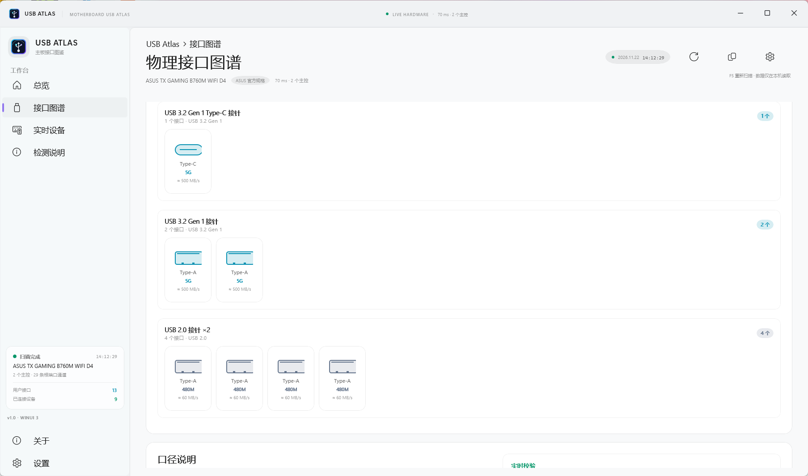
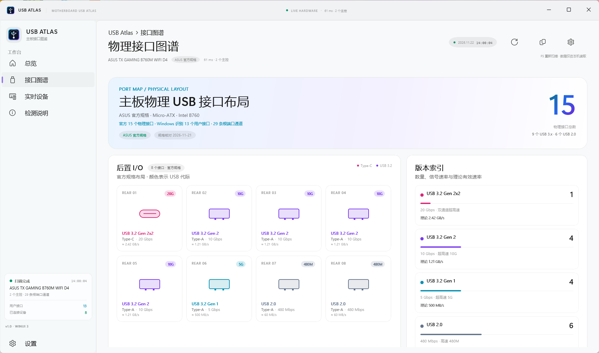
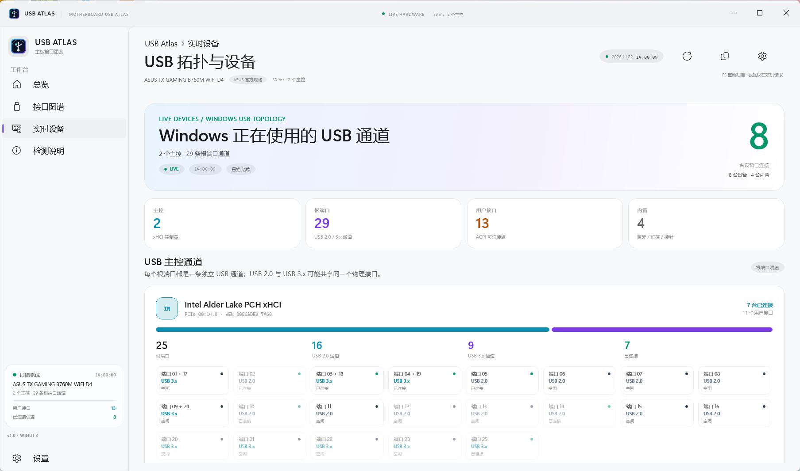
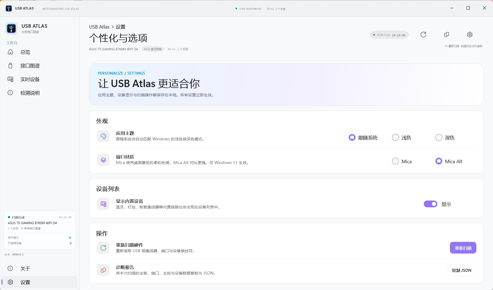
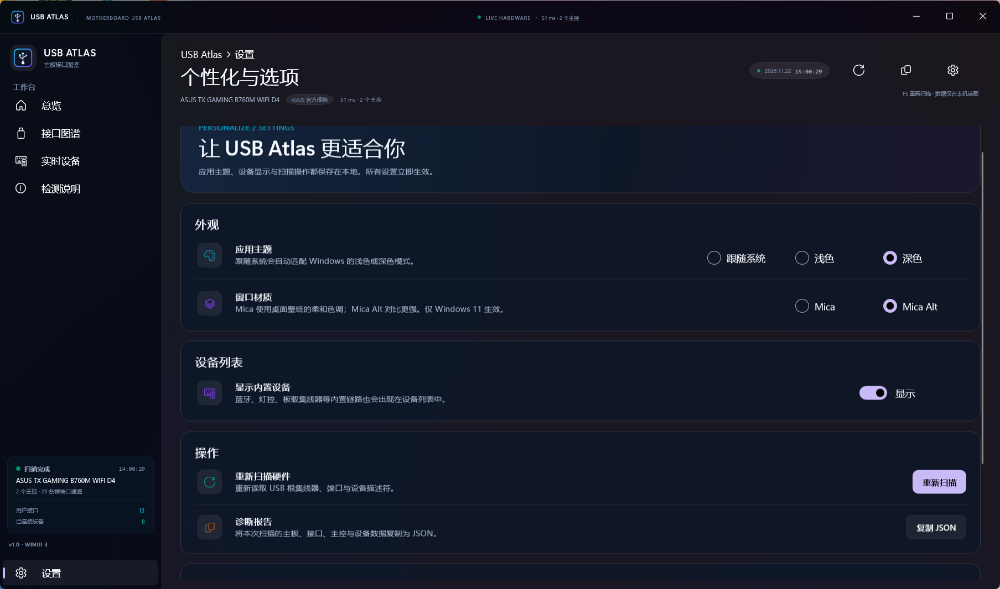

# USB Atlas · 主板 USB 接口图鉴

一个使用 **WinUI 3 / Windows App SDK** 全面重构的 Windows 桌面应用。打开后直接查看这台电脑主板的 USB 接口数量、USB 版本分布、后置 / 前置接口布局，以及当前正在连接的主控、根端口与设备。

这次重构把界面全部换成 WinUI 3 原生 Fluent 组合：系统浅色 / 深色主题、Mica 背景、NavigationView、CommandBar、原生设置卡片、可切换的 Mica / Mica Alt 材质和独立的“关于”页面。数据采集层保持本地、只读、无管理员权限。

**作者：** porserx & EXET · **开源协议：** MIT License · **源代码：** <https://github.com/porserx/usb-atlas> · **下载：** [GitHub Releases](https://github.com/porserx/usb-atlas/releases/latest)



## 打开方式

- 双击项目根目录的 [Start USB Atlas.bat](Start%20USB%20Atlas.bat)；
- 或直接运行 [dist/UsbAtlas.exe](dist/UsbAtlas.exe)。

`dist` 文件夹需要整体保留，不要只复制 exe。发布包已经包含 Windows App SDK 运行时，本机需要 **.NET 8 Runtime**。

## 这台电脑的识别结果

当前主板：**ASUS TX GAMING B760M WIFI D4**（Micro-ATX，Intel B760）

| 项目 | 数量 |
| --- | ---: |
| 物理 USB 接口 | **15** |
| USB 3.x 接口 | **9** |
| USB 2.0 接口 | **6** |
| USB 主控 | **2** |
| 根端口 USB 通道 | **29** |

按版本拆分：

- **1 × USB 3.2 Gen 2x2**：后置 Type-C，20 Gbps
- **4 × USB 3.2 Gen 2**：后置 Type-A，10 Gbps
- **4 × USB 3.2 Gen 1**：1 个后置 Type-A + 1 个前置 Type-C + 2 个前置 Type-A，5 Gbps
- **6 × USB 2.0**：2 个后置 Type-A + 4 个前置接针，480 Mbps

### 理论有效速率

除信号速率外，界面会按编码开销折算“理论有效速率”，并显示在每个版本卡片和端口卡片上：

| 版本 | 信号速率 | 编码 | 理论有效速率 |
| --- | ---: | --- | ---: |
| USB 3.2 Gen 2x2 | 20 Gbps | 128b/132b | **≈ 2.42 GB/s** |
| USB 3.2 Gen 2 | 10 Gbps | 128b/132b | **≈ 1.21 GB/s** |
| USB 3.2 Gen 1 | 5 Gbps | 8b/10b | **≈ 500 MB/s** |
| USB 2.0 | 480 Mbps | — | **≈ 60 MB/s** |

这里的“理论有效”只扣除了线路编码开销，不包含协议包、设备能力、线材和文件系统开销；实际复制速度会低于表中数值。将鼠标悬停在版本或端口卡片上可查看完整换算说明。

主控为 **Intel Alder Lake PCH xHCI**（25 个根端口）和 **ASMedia ASM2142**（4 个根端口）。截图扫描时连接了 8 台根端口设备，其中包含内置蓝牙、灯控和集线器；这个数字会随实际插拔变化。

> 15 个接口的口径来自华硕官方规格，包含前面板接针；Windows 实时扫描会把部分接针标记为内置，因此界面中的“用户可连接接口”通常少于 15 个。应用同时展示两套口径，不把规格数据伪装成实时结果。

## 界面

### 总览

物理接口总数、USB 3.x / USB 2.0 数量、代际占比、理论有效速率、实时根端口构成、两个主控和当前设备预览。


### 接口图谱

后置 I/O 逐口排列，颜色区分 USB 2.0 / Gen 1 / Gen 2 / Gen 2x2 与 Type-C；全部端口卡片同时显示编码折算后的理论有效速率。前置接针单独列出，并附带版本索引和统计口径说明。





### 实时设备

展示每个 xHCI 主控的根端口数、USB 2.0 / USB 3.x 通道、用户可连接组和已连接设备，包括设备名称、类型、协商速率与 VID:PID。



### 检测说明

说明官方规格、实时扫描、端口连接器属性各自的来源，以及为什么官方数量和实时识别数量可能不同。


### 设置

支持跟随系统 / 浅色 / 深色主题、Mica / Mica Alt 窗口材质、显示或隐藏内置设备、重新扫描，以及将本次扫描数据复制为 JSON 诊断报告。



## 主题

默认跟随 Windows 的应用主题；也可以在设置页固定浅色或深色。切换会立即应用到页面、标题栏按钮和设置控件。

窗口材质同样可选：

- **Mica**：更柔和的桌面壁纸色调
- **Mica Alt**：对比更强的 Mica 变体

两者都只在 Windows 11 生效；系统不支持时会自动退回兼容的亚克力背景。默认使用 **Mica Alt**，可在设置页随时切换。



设置会保存到 `%LOCALAPPDATA%\UsbAtlas\settings.json`。如果当前配置不允许写入 LocalAppData，会自动回退到程序目录下的 `settings.json`，不会影响应用启动。

## 数据口径

1. **物理接口数量与 Gen 版本**来自 `src/UsbAtlas.WinUI/Assets/board-profiles.json` 中的主板官方规格档案。
2. **连接状态**来自 Windows 实时 USB 拓扑；根端口数量和身份来自 USB Hub IOCTL。
3. Windows 只暴露空口的 USB 2.0 / USB 3.x 协议能力，无法逐口区分 Gen 1 / Gen 2，所以实时通道以 `USB 3.x` 聚合；Gen 版本由主板档案补齐。
4. 根端口包含蓝牙、灯控、前面板接针等内置链路，因此“29 条根端口通道”不等于 29 个外露接口。
5. 应用只展开根端口直连设备；外接集线器后面的键鼠、声卡等可能显示为集线器本身。
6. 如果主板型号不在档案中，应用会退化为 Windows 实时识别口径，只展示用户可连接接口，并明确标注“未匹配档案”。
7. 本机为 USB 3.2 平台；USB4 / Thunderbolt 的独立分类尚未加入。

## 技术栈

- **UI**：WinUI 3 / Windows App SDK 1.8，XAML + C#
- **运行时**：.NET 8，Windows x64
- **视觉**：Mica / Mica Alt / 亚克力背景、NavigationView、CommandBar、Fluent 卡片、Segoe Fluent Icons、自绘 USB-A / USB-C 接口图标
- **数据**：SetupAPI + USB Hub IOCTL、注册表、SMBIOS 信息、主板规格档案
- **依赖**：`Microsoft.WindowsAppSDK`、`Microsoft.Windows.SDK.BuildTools`

## 项目结构

```text
usb-atlas/
├─ Start USB Atlas.bat          # 双击启动
├─ dist/                        # 已发布的 WinUI 3 应用
│  ├─ UsbAtlas.exe
│  ├─ UsbAtlas.dll
│  ├─ UsbAtlas.pri              # XAML 资源索引
│  ├─ *.xbf                     # 编译后的 XAML 资源
│  ├─ Assets/board-profiles.json
│  ├─ LICENSE
│  ├─ USB-Atlas-source.zip    # 可离线打开的源码包
│  └─ Windows App SDK 运行时文件
├─ src/UsbAtlas.WinUI/
│  ├─ App.xaml / App.xaml.cs
│  ├─ MainWindow.xaml / .cs     # 标题栏、导航、CommandBar、全局状态
│  ├─ Views/                    # 总览 / 接口图谱 / 实时设备 / 检测说明 / 关于 / 设置
│  ├─ ViewModels/               # 页面数据、颜色、理论速率、展示模型
│  ├─ Controls/                 # USB 接口图标、版本分布条
│  ├─ Themes/                   # Colors / Styles / DataTemplates
│  ├─ Models/                   # AppSettings 等 UI 配置模型
│  ├─ Services/                 # 设置持久化
│  ├─ Shared/
│  │  ├─ Models/                # 主板、端口、设备数据模型
│  │  └─ Services/              # SetupAPI / USB Hub IOCTL / 注册表扫描
│  └─ Assets/
│     ├─ board-profiles.json    # 可扩展的主板规格档案
│     ├─ usb-atlas.ico
│     └─ usb-atlas.png
├─ docs/                        # 截图
├─ tools/publish-winui.ps1      # 重新发布脚本
├─ LICENSE                      # MIT License
├─ USB-Atlas-source.zip         # 源码压缩包
└─ README.md
```

## 开发与构建

要求：Windows 10 1809+ / Windows 11，.NET 8 SDK 或更高版本，x64。

```powershell
dotnet build .\src\UsbAtlas.WinUI\UsbAtlas.WinUI.csproj -c Debug -p:Platform=x64
```

重新发布：

```powershell
.\tools\publish-winui.ps1
```

发布使用 framework-dependent .NET + self-contained Windows App SDK。项目内的 publish target 会补齐 `.pri` 和 `.xbf` 资源，避免发布后启动空白。

调试时可以指定打开某个页面：

```powershell
.\dist\UsbAtlas.exe --view ports
.\dist\UsbAtlas.exe --view settings
```

## 扩展其他主板

编辑 `src/UsbAtlas.WinUI/Assets/board-profiles.json`，按下面结构增加档案，然后重新发布。应用通过厂商别名 + 型号匹配。

```json
{
  "manufacturerAliases": ["ASUS", "ASUSTeK COMPUTER INC."],
  "model": "TX GAMING B760M WIFI D4",
  "displayName": "ASUS TX GAMING B760M WIFI D4",
  "formFactor": "Micro-ATX",
  "chipset": "Intel B760",
  "specUrl": "https://www.asus.com/",
  "sourceLabel": "ASUS 官方规格",
  "verifiedOn": "2026-11-21",
  "rear": [
    {
      "type": "USB-C",
      "version": "USB 3.2 Gen 2x2",
      "versionKey": "usb32_20",
      "speedGbps": 20,
      "count": 1,
      "note": "后置 Type-C"
    }
  ],
  "front": [
    {
      "type": "USB-A",
      "version": "USB 2.0",
      "versionKey": "usb2",
      "speedGbps": 0.48,
      "count": 4,
      "header": "USB 2.0 接针 ×2"
    }
  ]
}
```

`versionKey` 可选：`usb32_20`、`usb32_10`、`usb32_5`、`usb2`。

## 关于

独立“关于”页展示项目信息、作者、开源协议和源代码入口。


- **作者**：porserx & EXET（设计 / 开发）
- **开源协议**：[MIT License](LICENSE)
- **源代码**：<https://github.com/porserx/usb-atlas>
- **本地源码包**：发布目录中的 `USB-Atlas-source.zip`

MIT 协议允许自由使用、修改、合并、发布、再授权或销售，只需保留版权声明和许可声明。

## 隐私

所有数据都在本机读取，不联网上传。应用不会写入 USB 设备，也不会修改 BIOS / 驱动 / 电源设置。

---

Copyright © 2026 porserx & EXET · Released under the MIT License.
